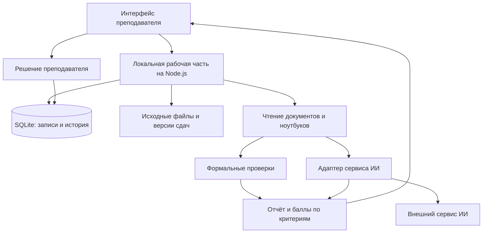

# Архитектура приложения «Практикум»

Структура исходного кода и назначение слоёв: [Карта проекта](PROJECT_STRUCTURE.md).

Статус: целевая архитектура с реализацией по этапам. Этапы 1 и 2 реализованы на JavaScript, React, Node.js, Electron и SQLite. Фактическое состояние см. в IMPLEMENTATION_STATUS.md и ../README.md.

## Реализованный поток работы (этап 2)

React → ограниченный IPC Electron → команды Node.js → SQLite и локальные файлы. Для браузерной разработки используется отдельный локальный HTTP-адаптер. Python в составе приложения не требуется.

Карточка студента или задание → пакет файлов → проверка формата → запись импорта pending → сохранение байтов в staging → перенос в files → ready и назначение версии сдачи. Ошибка одного файла не останавливает остальные. При старте незавершённые импорты восстанавливаются либо получают явную ошибку. Назначение автора выполняется преподавателем; оно не выводится из имени файла.

Оригинал и SHA-256 остаются локально. Подготовка копии читает оригинал, проверяет хеш, берёт зафиксированную версию задания и исключает побочные данные ноутбука. Внешний идентификатор копии — случайный requestId, не учебный номер. Связь с автором хранится в локальной базе. Редактирование копии создаёт новую неизменяемую редакцию. Отметка просмотра не равна утверждению оценки или гарантии анонимности. Сетевого адаптера ИИ пока нет.

## Назначение и границы

Приложение помогает преподавателю вуза проверять работы по программированию, сопоставлять их с требованиями задания и готовить обратную связь. ИИ предлагает замечания и баллы; преподаватель утверждает результат.

Первая версия рассчитана на одного преподавателя, работающего на одном компьютере, с несколькими курсами и группами. Локальные профили защищены паролем: он ограничивает доступ через приложение, но не шифрует базу и файлы на диске.

Поддерживаемый формат работы — ноутбук Python `.ipynb`. Проверка включает формальные правила и анализ содержания без запуска кода. В первой версии не рассчитываются штрафы за опоздание и итоговая оценка за весь учебный курс.

## Что уже существует

Рабочее приложение (этапы 1 и 2) находится в `Apps3`: `src/`, `backend/`, `desktop/`. Фактическое состояние — в [README](../README.md) и [IMPLEMENTATION_STATUS.md](IMPLEMENTATION_STATUS.md).

Первоначальный интерактивный макет на HTML/CSS/JavaScript перенесён в `Practice_3/archive/mockup-v0/`. Он хранит демонстрационные данные в браузере и служит образцом согласованного дизайна.

Исходные учебные материалы остаются отдельно в `Practice_3/testdata`. Их нельзя изменять при разработке или использовать как место хранения пользовательских данных приложения.

## Предлагаемое устройство

Предлагается локальное приложение с веб-интерфейсом на основе согласованного дизайна, рабочей частью на JavaScript и Node.js, базой SQLite и отдельным хранилищем файлов. Собственный облачный сервер на первом этапе не нужен.



База, файлы и ключ ИИ доступны только локальной рабочей части на Node.js. Предлагаемый интерфейс — React на JavaScript. Для десктопной версии предлагается Electron: интерфейс вызывает ограниченный набор команд через preload-мост и IPC, без прямого доступа к Node.js, SQLite и ключу ИИ. Отдельный HTTP-сервер для установленной версии не требуется.

По пожеланию пользователя приложение разрабатывается на JavaScript и Node.js, без Python. Python остаётся только языком проверяемых студенческих работ. Текущий прототип на HTML/CSS/JavaScript сохраняется как согласованный образец дизайна; рабочий интерфейс предлагается перенести на React. Electron предлагается как десктопная оболочка, React Native в текущий план не входит. React и Electron используются в рабочей версии этапа 1; версии зафиксированы в package.json и package-lock.json. Чтение ноутбуков и документов выполняется библиотеками JavaScript; запуск кода студентов не входит в первую версию.

## Основные части приложения

| Часть | Ответственность |
| --- | --- |
| Интерфейс | Курсы, задания, студенты, загрузка, отчёты и редактирование решений |
| Управление данными | Создание и изменение записей, копирование курса, проверка связей |
| Приём файлов | Сохранение оригиналов, проверка размера и формата, назначение автора |
| Чтение материалов | Получение текста требований и структуры ячеек ноутбука |
| Подготовка критериев | Черновик требований из документов, исправление и утверждение преподавателем |
| Формальные проверки | Предсказуемые проверки по настроенным правилам без ИИ |
| Проверка ИИ | Отправка подготовленных материалов, проверка структуры ответа, фиксация результата |
| Оценивание | Баллы по критериям, расчёт суммы, отделение предложений от решений преподавателя |
| История | Версии сдач, снимки требований, запуски проверок и утверждённые решения |

Для первой версии это части одного локального приложения, а не отдельные серверы или микросервисы.

## Организация курсов

Каждая папка курса представляет конкретное проведение дисциплины для группы: название, год, семестр, группа, номер курса и форма обучения. В интерфейсе показываются карточки и пункты левого меню.

Названия папок не определяют расположение файлов на диске. Записи связываются постоянными идентификаторами, поэтому переименование группы не ломает историю.

Общие правила принадлежат конкретной папке курса. У задания есть собственное условие, дополнительные требования и критерии с максимальными баллами.

Копирование курса создаёт независимый курс с копиями правил и заданий. Не переносятся студенты, сдачи, проверки и оценки. Загруженные документы правил также должны оставаться доступными в новой копии. Изменения копии не затрагивают исходный курс. Отдельный механизм общих шаблонов можно добавить позже.

## Подготовка задания к проверке

1. Преподаватель вводит текст или загружает документы с условием и правилами. Начальные форматы документов: PDF, DOCX и TXT.
2. Приложение извлекает текст. Если документ содержит сканы или неполный текст, показывает ограничение и предлагает вставить текст вручную. Распознавание сканов не является обязательной функцией первой версии.
3. ИИ предлагает структурированный список требований и критериев. Преподаватель также может составить его вручную без ИИ.
4. Преподаватель отмечает обязательные, необязательные и условные требования, уточняет баллы и разрешает противоречия.
5. Преподаватель утверждает версию задания для проверки.

Проверка использует одновременно общие правила курса и требования задания. Не вводится неявный приоритет, по которому один документ автоматически отменяет другой. Явные исключения сохраняются в утверждённом наборе требований.

Изменение общих правил не меняет уже утверждённые версии заданий. Для будущих проверок преподаватель создаёт и утверждает обновлённую версию.

## Приём работ и повторная сдача

1. Преподаватель выбирает курс и задание, затем один или несколько `.ipynb`.
2. Приложение сохраняет оригиналы локально и проверяет структуру файлов. Ошибка одного файла не отменяет приём остальных: для каждого файла показывается результат.
3. Приложение предлагает сопоставление со студентами группы. Неоднозначные случаи остаются без автора до ручного подтверждения. Нельзя надёжно определять автора только по имени файла.
4. Для уже существующей работы того же студента приложение предлагает сохранить новую версию сдачи. Нельзя молча заменять предыдущий файл.
5. Для каждой версии доступны исходный файл, предыдущие замечания и отдельные результаты проверок.

На первом этапе преподаватель вручную отмечает, исправлено ли замечание прошлой версии. Автоматический анализ различий откладывается.

Сдача моделируется как набор файлов, хотя интерфейс первой версии принимает один ноутбук на одну версию сдачи. Это оставляет возможность добавить папки проектов, ZIP и GitHub без изменения основных связей.

## Проверка и оценивание

Пакетная загрузка и пакетная проверка — разные действия. Преподаватель выбирает готовые работы и запускает проверку. Очередь первой версии обрабатывает их последовательно и показывает состояние каждой.

Перед анализом сохраняются снимок файла, утверждённые требования, параметры формальных проверок и инструкция ИИ. Повторный запуск создаёт новую запись.

Формальные проверки выполняются первыми. Результаты передаются в анализ содержания как контекст; приложение не должно дважды снижать баллы за одно нарушение.

Каждое замечание содержит тип, требование, объяснение, рекомендацию и место в исходной работе. Место для ноутбука — файл, номер ячейки с единицы, тип ячейки и, при необходимости, строки внутри неё. Номер относится к конкретной сохранённой версии. В интерфейсе должна быть возможность открыть этот фрагмент.

Типы замечаний: нарушение требования, рекомендация, предположение для проверки преподавателем. Дополнительное наблюдение, не связанное с утверждённым критерием, не уменьшает оценку автоматически.

ИИ предлагает баллы по каждому критерию. Рабочая часть проверяет, что критерий существует, балл входит в допустимый диапазон, а обязательные части ответа присутствуют. Итог считается программно как сумма баллов, а не берётся из произвольного текста ИИ.

Преподаватель может исправить замечания, изменить баллы по критериям и отредактировать сообщение. Утверждённое решение сохраняется отдельно от предложения ИИ. Изменение утверждённого решения создаёт новую версию решения с сохранением предыдущей.

Необязательные и условные требования не превращаются автоматически в штраф. При настройке задания нужно явно указать, как они участвуют в баллах. Начальная схема — критерии с диапазоном от нуля до максимума; отдельная система бонусов за пределами максимума не предусмотрена.

## Состояния и ошибки

Не следует хранить весь процесс в одном поле статуса. Есть состояние импорта, состояние проверки и состояние решения преподавателя.

- Импорт: принимается, сохранён, ошибка; отдельно — назначен ли автор.
- Проверка: в очереди, выполняется, завершена, завершена частично, ошибка, прервана.
- Решение: отсутствует, черновик, утверждено.

Если ИИ недоступен, результат формальных проверок сохраняется, но полный отчёт не объявляется готовым. Отсутствие ответа не означает отсутствие ошибок. После перезапуска приложения незаконченные проверки помечаются прерванными; преподаватель может повторить их новым запуском.

Отсутствующие входные данные, непрочитанный документ и неподдерживаемый фрагмент ноутбука показываются явно. Сохранённый вывод ячеек не доказывает корректность текущего кода. Код, команды оболочки и установочные инструкции из работы не исполняются.

## Где хранятся данные

| Данные | Предлагаемое место |
| --- | --- |
| Профили, курсы, студенты, задания, критерии и история | Локальная SQLite |
| Оригиналы документов и сдач | Отдельный каталог данных приложения |
| Снимки запросов и ответов проверки | Локальное хранилище с привязкой к запуску |
| Ключ поставщика ИИ | Защищённое хранилище учётных данных ОС |
| Настройки внешнего вида | Настройки приложения |

Для разработки используется каталог `Apps3/.local-data/`, исключённый из Git. В установленной версии — отдельный пользовательский каталог приложения, не папка исходного кода. Имя файла хранилища генерируется приложением; исходное имя сохраняется как метаданные.

Структура каталога данных разработки (полная карта исходного кода — в [PROJECT_STRUCTURE.md](PROJECT_STRUCTURE.md)):

```text
Apps3/
  .local-data/            только локальные данные разработки, вне Git
    practicum.sqlite3
    files/
    checks/
    staging/
```

Сохранение должно учитывать сбой между записью файла и записью в БД: сначала временный файл, затем проверка, перенос в постоянное хранилище и фиксация записи. Неполный импорт остаётся видимым как ошибка и может быть восстановлен или очищен. Нельзя показывать успешную загрузку, если исходный файл не сохранён.

Резервное копирование как пользовательская функция отложено по согласованию. Проверки целостности и аккуратная запись при сбоях нужны сразу.

## Доступ и внешние сервисы

В предлагаемой оболочке Electron интерфейс изолирован: contextIsolation включён, nodeIntegration выключен, sandbox включён. Preload-мост предоставляет только конкретные команды приложения. Рабочая часть проверяет отправителя IPC, входные параметры и принадлежность данных профилю. Произвольные команды, пути и доступ к файловой системе через интерфейс не разрешаются. Секреты и содержимое файлов не должны попадать в обычные журналы ошибок.

Перед передачей внешнему ИИ приложение формирует отдельную копию материала, исключает очевидные идентификаторы студента и позволяет преподавателю увидеть отправляемое содержимое. Удаление имени из шапки не гарантирует полной анонимности всего кода. Политика допустимой отправки учебных данных должна быть уточнена с вузом до использования реальных работ во внешнем сервисе.

Текст студенческой работы рассматривается как данные, а не инструкции для проверяющего ИИ. ИИ не получает доступ к произвольным файлам компьютера, сети или выполнению кода студента.

Адаптер поставщика ИИ принимает внутренний формат задания и работы и возвращает внутренний формат отчёта. Начинаем с одного поставщика; конкретную модель, бюджет и способ подключения выбираем перед этим этапом. Другие поставщики не требуют изменения интерфейса курсов и работ.

Для проверки сохраняются поставщик, название модели, версия инструкции, доступные параметры вызова, расход и длительность. Оценка стоимости помечается как расчётная. Повторный вызов даже с теми же параметрами может дать другой ответ.

## Этапы реализации и приёмка

| Этап | Результат | Как принимаем |
| --- | --- | --- |
| 1. Хранение | SQLite, файлы, курсы, студенты, задания и копирование | Создать данные, перезапустить приложение, проверить сохранность и независимость копии |
| 2. Сдачи | Пакетный приём, назначение авторов, версии | Загрузить несколько файлов, включая повреждённый, повторно сдать работу без потери первой версии |
| 3. Требования | Ввод и чтение документов, критерии, утверждённые версии | Изменение правил не меняет старую утверждённую версию |
| 4. Формальные проверки | Отчёт со ссылками на ячейки | Заранее известные нарушения обнаруживаются, корректные случаи не помечаются ошибками |
| 5. ИИ и решение | Анализ содержания, баллы, обратная связь, история | Проверить нормальный ответ, сбой сервиса, неверный ответ и исправление преподавателем |
| 6. Установка и оценка | Запуск на другом компьютере и независимое испытание | Преподаватель выполняет основной сценарий без помощи разработчика |

Демонстрационные записи не переносятся автоматически в рабочую базу как реальные студенты и оценки. Учебные примеры должны быть отделены от пользовательских данных.

Для диплома собирается набор заданий и работ с проверенными замечаниями. Данные для настройки и итогового измерения разделяются; варианты одной исходной работы не должны попадать в обе части. Измеряются время проверки, найденные и ошибочные замечания, расхождение баллов и исправления преподавателя. По двум работам обобщающие выводы не делаются.

## Возможности на будущее

Проекты и GitHub с фиксацией коммита, выполнение тестов в изолированной среде, автоматическое сравнение версий, аналитика, сравнение работ на сходство, интеграция с Moodle, резервное копирование, синхронизация и несколько преподавателей.

Для аналитики уже сейчас предусматриваются категории навыков, отдельные баллы по критериям и версии сдач. Сам интерфейс аналитики не входит в ближайшую реализацию.

## Что предлагается утвердить сейчас

1. Локальная архитектура: интерфейс, рабочая часть на JavaScript и Node.js, SQLite и отдельные файлы.
2. Один компьютер и локальные профили с паролем, без сетевых аккаунтов; вход через Google — подготовлен, не реализован.
3. Независимые копии курсов и неизменяемые сохранённые результаты проверок.
4. Сначала хранение и сдачи, затем требования и проверки, после них подключение ИИ.
5. React и Electron предлагаются для согласования; конкретная модель ИИ и бюджет выбираются перед подключением ИИ.

Этап 1 реализуется по указанию пользователя. Следующий этап — приём файлов и версии сдач. Приёмка описана в IMPLEMENTATION_STATUS.md.

## Уточнение технологического выбора

По просьбе пользователя Python исключён из реализации приложения. Предлагаемый состав: JavaScript, React, Node.js, Electron, SQLite. Работа остаётся локальной. TypeScript не вводится без отдельного обсуждения.

Основания устройства Electron: [модель процессов](https://www.electronjs.org/docs/latest/tutorial/process-model), [изоляция и безопасность](https://www.electronjs.org/docs/latest/tutorial/security).


## Вход и пароль (реализовано)

- Пароль профиля хранится только как хеш `scrypt` со случайной солью и параметрами (`auth_methods`). Код восстановления показывается один раз и тоже хранится только хешем. Сравнение — `timingSafeEqual`.
- Политика сложности — `backend/auth/password-policy.js`: `strict` (не меньше 8 символов и хотя бы 1 спецсимвол) и `test` (от 1 символа). Electron выбирает `strict` в установленной версии и `test` при разработке.
- Активный профиль хранится только в памяти рабочей части. После перезапуска нужен новый вход. После 5 неверных попыток — пауза 30 секунд (счётчик в памяти).
- Ограничение: база и файлы на диске не шифруются. Пароль защищает от входа через приложение, но не от чтения файлов другими программами под той же учётной записью Windows.

## Вход через Google (подготовлено, не реализовано)

Миграция 006 добавила таблицу `external_identities`: профиль, поставщик (`google`), постоянный идентификатор учётной записи Google (`sub`) и почта для показа. Одна учётная запись Google привязывается не больше чем к одному профилю, и у профиля не больше одной привязки Google. Токены Google в базу не записываются.

Планируемый способ для настольного приложения — OAuth 2.0 / OpenID Connect с PKCE:

1. Рабочая часть открывает страницу входа Google в системном браузере (не во встроенном окне Electron) с `code_challenge` и одноразовым `state`.
2. Google возвращает код на временный адрес `http://127.0.0.1:<порт>` — его слушает рабочая часть только на время входа.
3. Рабочая часть обменивает код на `id_token`, проверяет подпись, `iss`, `aud` (идентификатор клиента приложения), срок действия и `state`, берёт `sub`.
4. Если `sub` уже привязан — вход в соответствующий профиль. Привязка новой учётной записи выполняется только из профиля, в который уже выполнен вход по паролю.
5. Пароль остаётся запасным способом входа без интернета.

Для реализации нужен клиент OAuth типа «Desktop app» в Google Cloud Console. Секреты клиента не считаются защищёнными в настольном приложении, поэтому обязателен PKCE.

## Подключение OpenAI (реализовано, шаг 3)

- Поставщик `backend/ai/providers/openai.js`: `POST /v1/responses` встроенным `fetch`, `text.format` = строгая JSON-схема (упрощённая копия `responseSchema` без числовых ограничений), `store: false`, тайм-аут 120 с, до 2 повторов при 429/5xx, отмена через `AbortSignal`. При отказе показывается пояснение OpenAI (без ключа).
- Ключ: `backend/ai/key-store.js`, Electron `safeStorage`, файл в каталоге данных. Интерфейс ключ не получает.
- Подтверждение: `previewAiCheck` возвращает точный запрос и одноразовый токен на 5 минут; `runAiCheck` для OpenAI выполняется только с токеном и только если запрос не изменился. Одновременно — одна проверка OpenAI.
- Месячный лимит приложения и выбранная модель — таблица `ai_preferences` (миграция 009).
