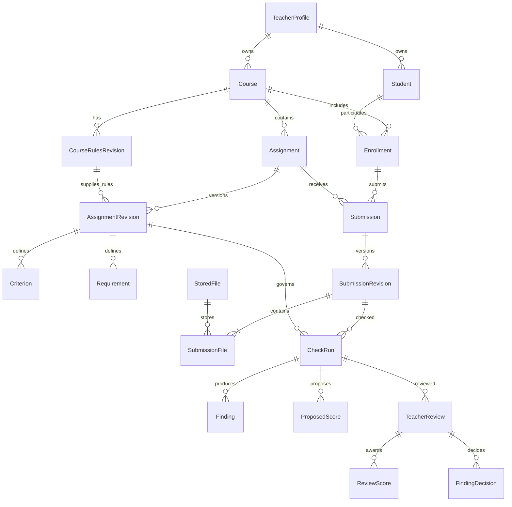

# Предлагаемая схема данных

Статус: целевая логическая модель. Реализованы миграции 001–008: профили, сдачи, вход, оценки преподавателя, формальные проверки и инфраструктура ИИ с mock-поставщиком. Реальная проверка ИИ остаётся следующим этапом. Текущее состояние описано в IMPLEMENTATION_STATUS.md. Названия сущностей в коде приведены для однозначности; пользовательский интерфейс остаётся на русском.

## Физическая схема этапа 2

Миграция № 2 добавляет четыре таблицы к существующей базе:

- `imports`: задание и его версия при загрузке, исходное имя, внутренний ключ файла, SHA-256, размер, число ячеек, состояние pending/ready/error.
- `submissions`: уникальная пара задания и участия студента в курсе.
- `submission_versions`: неизменяемый номер сдачи и ссылка на импорт; один импорт назначается один раз.
- `prepared_copies`: неизменяемые редакции копии для конкретной сдачи, случайный requestId, JSON-текст, результаты автоматической подготовки, отметка просмотра.

Исходные байты хранятся в files, а не в SQLite. Поля таблицы imports объединяют часть будущих сущностей StoredFile и ImportItem: пока каждая сдача состоит из одного ноутбука. Связи заданий с версиями требований существовали в миграции № 1.

## Миграция 003 — авторство, история и мягкое удаление

Миграции 001 и 002 не менялись; триггеры неизменяемости остаются включёнными. Обновление 2 → 3 транзакционно, без пересоздания существующих таблиц и потери оригиналов.

| Изменение | Назначение |
| --- | --- |
| enrollments.active | Действующее участие студента в группе. Исключение выставляет 0, связь остаётся для истории. Повторное добавление по прежнему учебному номеру активирует ту же связь. |
| author_events | Неизменяемый журнал назначений: импорт, сдача студента, номер, предыдущее событие, снимки имени и номера, преподаватель и время. |
| current_authors (представление) | Последнее событие каждой цепочки назначений, то есть текущий автор импорта. |
| copy_author_contexts | Связывает каждую редакцию копии с назначением автора, при котором она была подготовлена. |
| copy_invalidations | Неизменяемые отметки недействительности копий: причина и дата. |
| work_deletions | Неизменяемая отметка мягкого удаления: импорт, преподаватель и время. |

Для всех сдач схемы 2 создаются исходные author_events с теми же идентификаторами и номерами, что у submission_versions. Подготовленные копии связываются с соответствующими событиями. Старые поля и данные не переписываются. Новые журналы также защищены триггерами от UPDATE и DELETE.

**Смена автора.** Исходная submission_versions остаётся неизменной и служит постоянной ссылкой на импорт для prepared_copies. Новый author_event связывает импорт с submissions нового студента; previous_id указывает на прежнее назначение. Копия ссылается одновременно на исходную сдачу и через copy_author_contexts — на актуальное назначение. Текущий автор и номер для интерфейса всегда берутся из current_authors, а не из исходной submission_versions.

**Нумерация.** Следующий номер равен MAX(author_events.version) + 1 для пары задание–участие студента в курсе. Все когда-либо выданные номера сохраняются; переназначенные и удалённые сдачи не перенумеровываются, номера не используются повторно. Например: у A была № 1, у B — № 1; перенос работы A к B создаёт B № 2. Следующая загрузка A получит № 2. Возврат той же работы к A после этого получит № 3. В текущем списке могут быть пропуски: прежнее назначение и его номер видны в истории работы. Наличие прежних номеров требует подтверждения новой версии, даже если прежние работы уже скрыты или переназначены.

**Копии.** При смене автора все прежние редакции получают отметку недействительности. Они остаются в prepared_copies и перечисляются в истории с причиной, но не возвращаются как текущие и не могут быть сохранены из устаревшего окна. Новая подготовка использует актуальную карточку автора и новый requestId; общий номер редакции копии продолжает расти. Проверка expectedAuthorEventId отклоняет устаревшее переназначение. Редактирование карточки студента само по себе не изменяет и не переписывает уже подготовленные копии.

**Удаление и студенты.** Удалённый импорт исключён из текущих выборок и любых операций назначения, подготовки, сохранения копии и чтения оригинала через интерфейс. Файл и история сохраняются; восстановление удалённой работы пока не предусмотрено. Исключение из группы запрещено, пока есть хотя бы одна неудалённая работа с текущим назначением этому студенту в любом задании курса. Исторические назначения после переноса и мягко удалённые работы не препятствуют исключению. Имя и номер редактируются в общей карточке профиля, поэтому исправление видно во всех курсах; непустой номер уникален в пределах профиля.

**Транзакции.** Каждая изменяющая команда, включая импорт, подготовку и сохранение копии, выполняется в одной транзакции базы. SQL находится в репозиториях. При ошибке вся запись и история команды откатываются. Файловая система не поддерживает общую транзакцию с SQLite: если ошибка или авария произошла после записи байтов, файл может остаться без записи в базе; автоматическое удаление таких файлов не выполняется. Незавершённые импорты pending, оставшиеся от предыдущей версии приложения, продолжают восстанавливаться при старте.

## Миграции 004–006 — вход, архив, оценки, внешние учётные записи

- **004** `auth_methods`: хеш пароля, соль, параметры scrypt, хеш и соль кода восстановления для профиля (`type='password'`). Удаляет сохранённый активный профиль из `settings` — сессия теперь только в памяти. Добавляет `assignments.archived`.
- **005** `teacher_reviews`: версия решения преподавателя по работе (импорт, назначение автора, версия задания, номер версии, ссылка на предыдущую, `draft`/`approved`, отзыв, автор, дата). `review_scores`: балл по критерию в половинах балла и комментарий. Триггер проверяет, что критерий принадлежит версии задания и балл не превышает максимум; в утверждённом решении баллы обязательны. Обе таблицы неизменяемы (новая версия вместо правки).
- **006** `external_identities`: привязка внешней учётной записи к профилю (`provider='google'`, `subject` = Google `sub`, почта для показа). Уникальны пара поставщик + идентификатор и пара профиль + поставщик. Токены не хранятся.

## Миграция 009 — поставщик OpenAI

- `check_runs` пересоздана с переносом данных: поставщик теперь `mock` или `openai`; таблицы `check_scores`, `check_findings` и триггеры восстановлены без изменений.
- `ai_preferences` (одна строка): модель по умолчанию и месячный лимит расходов приложения. Ключ API в базе не хранится.
## Сущности и связи

| Сущность | Назначение и основные данные |
| --- | --- |
| TeacherProfile | Локальный профиль: идентификатор, имя, настройки |
| Course | Проведение дисциплины: владелец, название, год, семестр, группа, номер курса, форма обучения, ссылка на исходный курс при копировании |
| Student | Студент в пространстве преподавателя: идентификатор, имя, необязательный учебный номер |
| Enrollment | Связь студента с курсом; один студент может участвовать в нескольких курсах |
| CourseRulesRevision | Версия общих правил курса: текст, документы-источники, дата, состояние черновика или утверждённой версии |
| Assignment | Постоянная карточка задания в курсе; текущая версия и порядок отображения |
| AssignmentRevision | Версия задания: название, условие, дополнительные требования, версия общих правил, снимок итоговых требований, максимум баллов, состояние утверждения |
| Criterion | Критерий внутри версии задания: название, максимум, правила начисления, категория навыка |
| Requirement | Проверяемое требование: текст, обязательность или условие применимости, источник, параметры формальной проверки, связанный критерий при наличии |
| Submission | Работа студента по заданию: связь с Assignment и Enrollment |
| SubmissionRevision | Конкретная сдача: номер версии, время импорта, источник, предыдущая версия |
| StoredFile | Сохранённый файл: внутренний путь, исходное имя, размер, контрольная сумма, формат и состояние записи |
| SubmissionFile | Связь файла с версией сдачи: путь внутри проекта и роль файла |
| SourceDocument | Связь исходного документа с версией правил или задания; извлечённый текст и результат чтения |
| ImportItem | Элемент пакета загрузки: файл, состояние, предполагаемый или назначенный автор, причина ошибки |
| CheckRun | Запуск проверки конкретной сдачи по конкретной версии задания: состояние, снимок настроек, версия формальных проверок, инструкция ИИ, модель, время и расход |
| Finding | Замечание запуска: тип, требование, текст, доказательство, рекомендация, ссылка на файл и ячейку |
| ProposedScore | Предложенный балл по критерию в рамках запуска, обоснование |
| TeacherReview | Версия решения преподавателя: запуск, состояние, дата утверждения, обратная связь, предыдущая версия решения |
| ReviewScore | Балл преподавателя по критерию, обоснование изменения |
| FindingDecision | Решение по замечанию: принято, исправлено, отклонено; уточнённая формулировка и комментарий |
| Remediation | Ручная отметка об исправлении замечания прошлой сдачи в новой версии работы |

Диаграмма показывает основные связи. Импорт, документы-источники и отметки повторной сдачи описаны в таблице отдельно, чтобы схема оставалась читаемой.

## Правила целостности

- Идентификаторы постоянны и не зависят от названий папок, имён студентов или имён файлов.
- Enrollment уникален для пары студент–курс. Submission уникальна для пары задание–участие студента в курсе.
- Задание и студент в Submission должны относиться к одному курсу. Все связи проверяются также на принадлежность текущему профилю.
- Работа без установленного автора остаётся элементом импорта; полноценная Submission создаётся после назначения автора.
- Имя студента не является уникальным идентификатором: однофамильцев разрешено хранить отдельно. Сопоставление всегда допускает ручное исправление до проверки.
- Номер версии сдачи уникален внутри Submission. Файл старой версии не перезаписывается.
- Контрольная сумма помогает обнаружить повторную загрузку тех же байтов, но не определяет авторство или плагиат.
- Criterion и Requirement принадлежат конкретной версии задания. Новый набор критериев не изменяет старый.
- Сохраняются тексты утверждённых правил и снимки входных материалов. Одного номера версии недостаточно, если исходный текст можно изменить.
- На завершённую проверку записывается не более одного ProposedScore для каждого критерия. Балл лежит в диапазоне от нуля до максимума; отсутствие оценки не заменяется нулём.
- Полный итог доступен, только когда есть допустимые оценки по всем оцениваемым критериям. Статусы «не применимо» разрешаются по заранее утверждённым правилам задания.
- Итог складывается программно. Для точного хранения шагов оценивания предлагаются целые единицы по 0,5 балла для первой версии; поддержка другого шага требует явного решения.
- Завершённый CheckRun не редактируется. Исправленный ответ или повторная попытка сохраняются новым запуском. Его состояние может изменяться во время выполнения, а результат после завершения фиксируется.
- Черновик TeacherReview редактируется; утверждённое решение неизменяемо. Коррекция создаёт новую версию с указанием предыдущей.
- Баллы ИИ и преподавателя хранятся независимо по каждому критерию. Изменение текста обратной связи не меняет исходный ответ ИИ.
- Копирование курса создаёт новые записи и независимые версии правил и заданий. Работы, история, оценки и состав группы не копируются.
- Внешние ключи SQLite и транзакции должны быть включены и использоваться рабочей частью. Удаление курса не должно каскадно стирать историю без отдельного согласованного сценария.

## Пример одного рабочего процесса

1. Создан курс «Программирование», ПЛП, весна 2026.
2. В курс включён студент; создано задание «Структуры данных».
3. Утверждена версия задания № 1 с критериями и правилами.
4. Принят файл и создана версия сдачи № 1.
5. Запуск проверки № 1 ссылается на сдачу № 1 и задание версии № 1.
6. ИИ предложил баллы; преподаватель сохранил своё утверждённое решение № 1.
7. Студент прислал исправление: создаётся сдача № 2, старые данные остаются.
8. Если преподаватель изменил критерии, создаётся версия задания № 2. Для следующей проверки явно выбирается утверждённая версия; история показывает, что условия оценивания изменились.

## Что не хранить в обычных таблицах и журналах

Ключ доступа к сервису ИИ не хранится в SQLite, исходном коде, localStorage или журнале ошибок. Для него используется хранилище учётных данных ОС.

Исходники студентов и документы не записываются в журнал ошибок. Полные материалы проверки сохраняются только в предназначенном для этого локальном хранилище и связываются с CheckRun.

Пользовательские данные, ключи, локальная база и файлы студентов не включаются в Git. Для автоматических проверок ядра создаются отдельные обезличенные примеры.

## Что уточнить до SQL-миграций

1. Достаточен ли шаг оценивания 0,5 балла или нужны, например, десятые доли?
2. Нужен ли учебный номер для надёжного различения студентов, или сначала достаточно имени и ручного выбора?
3. Какая ОС нужна для первой устанавливаемой версии? Текущая среда разработки — Windows.

Эти уточнения не требуют изменения согласованного дизайна; они определяют ограничения хранения и установку.

## Миграция 007 — формальные проверки (08.11.2026)

- `formal_check_settings`: одна неизменяемая JSON-запись на `assignment_revisions.id`. Включение шести проверок, шаблон имени файла, число задач, ключевые слова формы. Старые версии получают значения по умолчанию при миграции. Новая версия сохраняет настройки прежней, если команда не передала новые. Копирование курса переносит настройки в независимые версии.
- `formal_check_runs`: UUID, импорт, закреплённая версия задания, событие назначения автора, время, версия алгоритма (1), JSON результатов `{check,status,message,cell}`. Номер ячейки с 1, либо null. Каждый повторный запуск — новая строка. Последний определяется порядком вставки, не совпадением времени.
- Обе таблицы защищены триггерами от UPDATE/DELETE. Триггер вставки запуска проверяет связь импорта, версии задания и текущего автора, готовность импорта и отсутствие мягкого удаления. Старые миграции и их триггеры не менялись.
- Запуск выполняется одной транзакцией, проверяет владельца профиля/курса, назначенного автора, целостность оригинала по SHA-256. Чтение результатов проходит те же проверки доступа. После переназначения автора старая история остаётся в базе, но текущие результаты требуют нового запуска; удалённые работы недоступны.
- Результат не хранит исходный текст, имя файла, имя, номер или почту студента. Настройки не повторяются в запуске: на них ведёт ссылка на неизменяемую версию задания. Никаких сетевых вызовов и исполнения студенческого кода.

## Миграция 008 — инфраструктура ИИ с mock-поставщиком

Миграция самостоятельная, значения по умолчанию записаны внутри файла, рабочие модули не импортируются. Миграции 001–007 не менялись. Старые копии не модифицируются и не получают задним числом ключи.

- `assignment_languages`: неизменяемый язык отзыва для версии задания; для существующих версий — «эстонский». Поле команды saveAssignment — feedbackLanguage (до 80 символов), пока без нового элемента интерфейса. При редактировании без этого поля сохраняется прежний язык; копирование курса переносит его.
- `copy_criteria`: copy_id + key (C1…Cn по position) → criteria.id; уникальны ключ и критерий внутри копии. Записи неизменяемы, связь проверяется с версией задания исходной сдачи. Новая редакция копии наследует связи; старую копию без ключей требуется подготовить заново.
- `check_runs`: импорт, событие автора, версия задания, точная редакция просмотренной копии, mock/model, версия инструкции, queued/running/completed/failed/interrupted, даты создания/начала/окончания, токены, расчётная стоимость, ошибка, снимки запроса и ответа, отзыв. В mock расход нулевой.
- `check_scores`: run_id + criterion_id, целые половины балла, обоснование. Триггер проверяет диапазон и принадлежность критерия.
- `check_findings`: тип violation/recommendation/assumption, необязательные ключ критерия и номер ячейки, текст и рекомендация. Триггер проверяет ссылки по снимку запроса.

Переходы состояний ограничены триггерами. Запрос и связи запуска не меняются. Завершённые, ошибочные и прерванные запуски неизменяемы. Баллы и замечания добавляются только в running и не редактируются/не удаляются. При completed количество баллов должно совпадать с количеством критериев. Failed/interrupted не могут содержать частичные результаты.

Асинхронная команда разделена на короткие транзакции: создание queued, переход running, атомарная запись всех проверенных результатов и completed (либо failed). Во время ожидания поставщика транзакция не удерживается. Перед сохранением повторно проверяется доступ, наличие работы и неизменность автора. При запуске приложения queued/running переводятся в interrupted одной транзакцией.

Запрос собирается только из разрешённых полей последней просмотренной действительной копии текущего автора, закреплённого языка и последних формальных результатов этого автора. Более новая непросмотренная редакция не подменяет просмотренную. Карточка студента, исходное имя файла, выводы и метаданные не добавляются. Инструкция запрещает упоминать имена людей, но это правило инструкции, а не автоматическая гарантия отсутствия всех имён в будущем ответе реальной модели.
